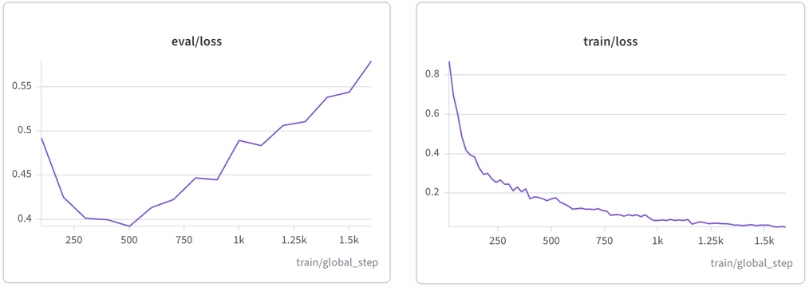

## Overview

LLM baseline for testing whether predictions of
multi-step reaction mechanisms are *semigroup-consistent*.

**Task** Given the SMILES of the current state of a reaction system, predict the
state after *k* elementary mechanistic steps.

**Question** For a model trained only on outcome supervision (pairs $(s_t, k) → s_{t+k}$),
do predictions over different step partitions agree? That is, does the direct
prediction $\phi_k(s$) match the composed prediction $\phi_{k_m} ∘ … ∘ \phi_{k_1}(s)$
for $k_1 + … + k_m = k$?

**Approach** Finetune *Qwen2.5-1.5B-Instruct* with LoRA on k ∈ {1, 2, 3}, and
evaluate both direct and composed predictions on held-out reactions. We report
accuracy and consistency jointly, together with a zero-shot reference.

## Data
`data_pipeline/`: data.py, split.py, samples.py, prompts.py

Each reaction is a trajectory of states $s_0 → s_1 → … → s_T$ (T = 1–10), where each state is the canonical SMILES (RDKit, explicit H removed) of all species in the reaction system, and consecutive states differ by one elementary mechanistic step.

**Split** Reactions are split 384 / 23 / 49 (train / val / test), stratified by trajectory length. The split is done at the reaction level, so all samples derived from one reaction stay in the same split.

**Sample construction** Each trajectory is expanded into all triples $(s_t, k, s_{t+k})$.
 For example, during **training** a 3-step reaction $s_0 → s_1 → s_2 → s_3$ yields 6 training samples:

| k | samples |
|---|---|
| 1 | $s_0 → s_1, s_1 → s_2, s_2 → s_3$ |
| 2 | $s_0 → s_2, s_1 → s_3$ |
| 3 | $s_0 → s_3$ |

In the **testing**, it yields [1,1,1] vs [3], [1,2] vs [3], and [2,1] vs [3].

Train and validation keep only samples with k ≤ 3; the test set keeps all k, with k ≥ 4 used for extrapolation.

**Prompt** The model receives the following user message (wrapped in the Qwen chat template) and is trained to output the SMILES of $s_{t+k}$:

    Below is the SMILES of the current state of a reaction system (molecules separated by '.').
    {source}
    Predict the state of the system after {k} elementary mechanistic step(s). Output only the SMILES.

Training uses standard SFT, with the loss computed only on the target tokens.

## Model & Training

Finetune Qwen2.5-1.5B-Instruct with LoRA (rank 8, alpha 16, dropout 0.10) applied to the attention projections ($q_proj, k_proj, v_proj, o_proj$). Training runs for 10 epochs with batch size 16, learning rate 2e-4 with a cosine schedule and 3% warmup, weight decay 0.01, in bf16. Evaluated every 100 steps, and the checkpoint with the lowest validation loss is kept as the final LoRA adapter.

## Inference & Evaluation
`evaluation/`: infer.py, evaluate.py

**What we compare** For each test sample $(s_t, k, s_{t+k})$, the model is queried in several ways that should give the same answer if its predictions were semigroup-consistent:

- **Direct**: a single call asking for the state after k steps, $\Phi_k(s_t)$.
- **Composed**: a chain of calls whose step counts sum to k, where each call's prediction (canonicalized) becomes the next call's input, e.g. $\Phi_1(\Phi_2(s_t)$) for the partition [2,1]. If any intermediate prediction is not valid SMILES, the chain stops and the result counts as invalid.

The partitions used are [1,1] for k = 2; [1,1,1], [1,2] and [2,1] for k = 3; and [1,…,1] for k ≥ 4. Composed partitions only contain segments with k ≤ 3, so every call uses an instruction seen during training. All generation uses greedy decoding.

**Correctness** A prediction is correct if its canonical SMILES exactly matches the ground truth $s_{t+k}$. Each prediction is labeled **correct, valid but incorrect, or invalid (not parseable by RDKit**).

**Consistency** For each sample, the direct prediction is compared with each composed prediction, and the pair falls into one of five cases: (a) both correct, (b) only direct correct, (c) only composed correct, (d) both wrong but identical, (e) both wrong and different, including any pair with an invalid prediction. From these we report:

- direct accuracy = a + b, composed accuracy = a + c;
- consistency = a + d, the fraction of pairs giving the same answer;
- conditional consistency = a / (a + b + c), the fraction of pairs giving the same answer among those where at least one is correct.

Conditional consistency excludes pairs where both predictions are wrong, which disagree for trivial reasons when accuracy is low.

**Reported results** evaluate.py writes four CSV files:
- **per_sample.csv** — one row per prediction, i.e. per test sample and partition. Columns: reaction_id, t, k, step_count, has_branching, partition, source, target, the predicted and ground-truth canonical SMILES, generation diagnostics (terminated_by_eos, hit_max_new_tokens, n_generated_tokens, repetition_flag, generation_failure, truncated), the correctness label (invalid, valid_but_incorrect, correct), failed_at_step for composed chains, and whether each intermediate step matched the ground-truth intermediate state.

- **accuracy.csv** — one row per k and partition: k = 1 ([1]); k = 2 ([2], [1,1]); k = 3 ([3], [1,1,1], [1,2], [2,1]); and for each extrapolation bin (4–5, 6–10), one row for direct and one for [1,…,1]. Columns: number of samples, number of source reactions, validity, accuracy (with 95% CI), invalid rate, valid-but-incorrect rate.

- **consistency.csv** — one row per comparison: [2] vs [1,1]; [3] vs [1,1,1], [3] vs [1,2], [3] vs [2,1]; and [k] vs [1,…,1] for each extrapolation bin. Columns: number of samples, number of source reactions, direct accuracy, composed accuracy, consistency, conditional consistency (each with 95% CI), the proportions of cases a–e, and the invalid rates of the direct and composed predictions.

- **diagnostics.csv** — one row per k and partition (every k listed separately). Columns: number of samples, and the fractions of predictions that terminated with the end token, hit the generation length limit, were flagged for repetition, or produced no output.

## Results

### Overfitting

PS: All results below use the checkpoint with the lowest validation loss (step 500).

### What did the SFT model learn?

For k=1 direct predictions (184 test samples):

| Metric | Value |
|--------|-------|
| Valid SMILES | 47.8% |
| Invalid SMILES | 52.2% |
| Correct (exact match) | 1.6% |
| Valid but incorrect | 46.2% |

For k = 1
- 52.2% of the outputs are invalid SMILES. The invalid outputs mostly fail because of unclosed rings, valence errors, kekulization failures, and unbalanced parentheses. 
- 47.8% are valid but only 1.6% matching the ground truth. The model has partially learned to write well-formed SMILES, but has not learned the reaction transformations.

For larger k
- Direct prediction gets worse as k increases: validity drops from 47.8% at k = 1 to 38.5% at k = 2.
- Composed predictions almost all fail. A composed query makes several calls in a row, each taking the previous output as its input. If any intermediate step produces an invalid SMILES, the whole chain breaks.

### SFT vs Zero-shot

The zero-shot base model (Qwen2.5-1.5B-Instruct without fine-tuning) produces 0% validity and 0% accuracy across all k. It outputs natural language instead of SMILES. This confirms that SFT did teach the model something.

**Example, Same input, k=1:**

```
Source:    FC(F)(F)c1ccc2c(C3CC[NH+](CCCOc4cccc5[nH]ccc45)CC3)c[nH]c2c1
           .O=C([O-])[O-].[Cl-].[K+].[K+]
Target:    FC(F)(F)c1ccc2c(C3CCN(CCCOc4cccc5[nH]ccc45)CC3)c[nH]c2c1
           .O=C([O-])O.[Cl-].[K+].[K+]

SFT:       C[C+](C)C.F.C(=O)[O-].O.[Cl-].[K+].[K+]
           → valid SMILES, wrong answer

Zero-shot: "To predict the state of the system after one elementary
            mechanistic step, we need to consider possible reactions
            that could occur between the molecules ..."
           → natural language, not SMILES at all
```
